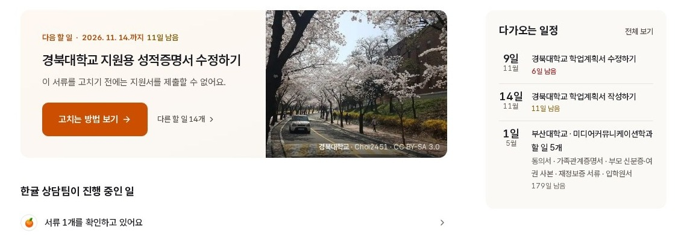
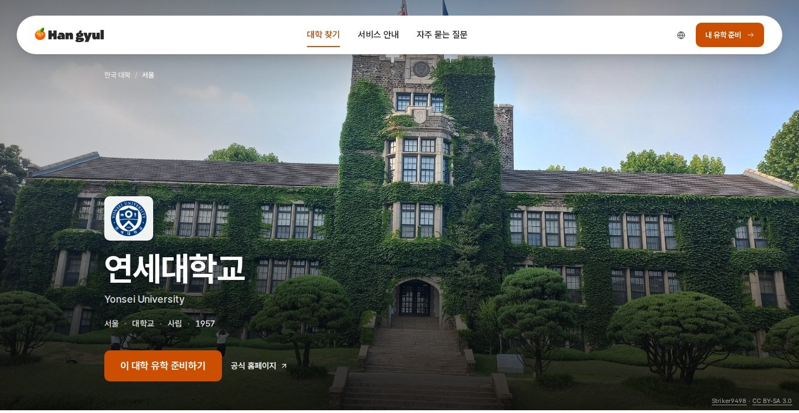
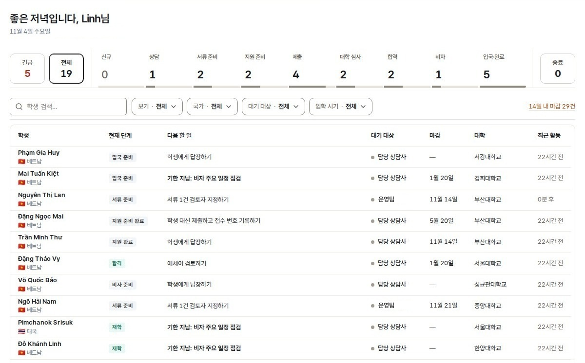
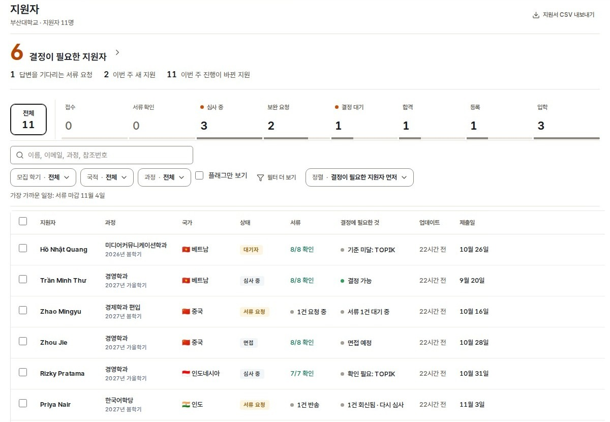

<!--
  편집 안내
  - 이 파일이 원본입니다. PDF는 `node scripts/docs/service-plan-pdf.mjs`로 다시 만듭니다. PDF는 docs/media/한귤유니브_서비스기획서.pdf 에 저장됩니다.
  - `## ` 하나가 PDF 한 페이지입니다. 앞의 두 자리 숫자는 페이지 위 작은 번호로 표시됩니다.
  - ```cards```, ```flow``` 같은 블록은 한 줄에 항목 하나, 칸은 ` | `로 나눕니다.
  - 화면 이미지는 docs/media/service-planning/ 에 있습니다.
-->

## 01 한귤 유니브는 무엇인가

학생이 원하는 한국 대학에 더 잘 지원할 수 있도록, 한귤이 준비의 완성도를 높이고 복잡한 지원 과정을 대신 챙기는 유학 준비 서비스입니다.

```relation
학생 | 준비하고 지원합니다
한귤 유니브 운영팀 | 지원 전 과정을 직접 돕습니다
한국 대학 | 검토하고 입학을 결정합니다
```

학생 상담과 지원 관리는 한귤 유니브 운영팀이 직접 맡습니다. 중간에 외부 유학원이나 별도의 운영 파트너를 두지 않습니다. 대학 추천부터 서류 검토, 자기소개서 첨삭, 비자와 입국 준비까지 한 팀이 이어서 봅니다.

### 서비스 안에서 만나는 사람들

```users
학생 | 한국 유학을 준비하고 실제 대학 지원을 진행하는 외국인 학생 | 원하는 대학에 합격할 가능성을 높이고, 필요한 준비를 빠짐없이 끝내는 것 | 공개 웹사이트, 학생 웹, 학생 앱
한귤 유니브 운영팀 | 학생의 상담, 추천, 지원, 서류, 일정, 입국 준비를 맡는 한귤 내부 담당자 | 학생마다 지금 상황과 다음 할 일을 빠르게 파악하고, 놓치는 일이 없게 하는 것 | 운영자 웹, 운영자 앱
대학 | 국제학생 입학을 담당하는 대학 관계자 | 지원자를 검토하고 국제학생 모집 현황과 결과를 확인하는 것 | 대학 콘솔 웹과 앱
```

## 02 학생이 한귤 유니브를 쓰는 이유

> 한귤 유니브의 목표는 학생이 원하는 대학에 합격할 가능성을 최대한 높이는 것입니다.

대학 목록이나 체크리스트를 보여주는 데서 끝나지 않습니다. 학생이 원하는 대학에 더 좋은 지원서를 낼 수 있도록 준비의 질을 함께 끌어올립니다.

```cards 3
원하는 대학 찾기 | 조건과 목표에 맞는 대학을 찾습니다. 이미 가고 싶은 대학이 있다면 그 대학에 필요한 조건과 부족한 부분부터 확인합니다.
더 잘 지원하기 | 대학별 모집요강을 확인하고 서류와 자기소개서, 학업계획서를 제대로 준비합니다.
끝까지 놓치지 않기 | 대학의 추가 요청과 결과, 합격 후 준비까지 한귤이 계속 챙깁니다.
```

### 한귤이 책임지는 것과 대학이 정하는 것

```dodont plain
한귤이 책임지는 것 | 지원 전략, 준비의 완성도, 서류의 정확성, 마감 일정, 대학 요청 대응
대학이 정하는 것 | 합격 여부
```

그래서 합격을 약속하거나 합격 확률을 계산해 보여주지 않습니다. 한귤이 책임질 수 있는 준비의 질로 합격 가능성을 높입니다.

## 03 학생이 겪는 문제

한국 유학 정보는 대부분 공개되어 있지만, 흩어져 있고 대학마다 형식이 다릅니다. 학생 혼자 판단하고 준비하기에는 너무 많습니다.

```compare 학생이 겪는 어려움 | 한귤 유니브에서는
내 성적으로 어느 대학에 도전해야 할지 판단하기 어렵습니다. | 지금 조건으로 검토해볼 대학을 넓게 보여주고, 목표 대학에 필요한 조건과 부족한 부분을 함께 짚어 줍니다.
대학마다 모집요강과 필요한 서류가 달라 직접 찾아야 합니다. | 대학 공식 모집요강을 기준으로 지원서마다 필요한 서류를 정리해 둡니다.
서류 하나의 실수나 누락이 불이익으로 이어질 수 있습니다. | 제출 전에 한귤 운영팀이 빠진 서류와 내용, 마감을 확인합니다.
번역, 공증, 아포스티유가 필요한지 알기 어렵습니다. | 서류를 발급한 나라에 맞춰 필요한 인증 절차와 번역 여부를 서류마다 알려줍니다.
지원하고 나면 대학이 더 필요한 게 있는지, 내가 할 일이 있는지 알기 어렵습니다. | 대학의 추가 요청과 결과를 한 곳에서 알려주고, 학생이 할 일이 생기면 바로 안내합니다.
합격 후 비자, 기숙사, 입국 정보가 흩어져 있습니다. | 합격 후 준비도 같은 곳에서 이어서 안내합니다.
```

## 04 학생은 이렇게 준비합니다

학생에게 유학 준비는 다섯 덩어리입니다. 학생 화면은 이 흐름을 기준으로 생각하면 됩니다.

```flow
대학 찾기 | 내 조건과 목표에 맞는 대학을 찾습니다.
지원 준비 | 입학 조건을 확인하고 필요한 서류를 준비합니다.
지원 | 지원서를 완성해 대학에 제출합니다.
결과 기다리기 | 대학의 요청이 오면 대응하고, 없으면 결과를 기다립니다.
합격 후 준비 | 등록, 비자, 기숙사, 입국을 준비합니다.
```

### 지원한 뒤에는 할 일만 분명하게

학생이 궁금한 것은 내부 심사 단계가 아닙니다. 지원이 잘 들어갔는지, 대학이 더 필요한 게 있는지, 지금 내가 할 일이 있는지입니다. 할 일이 없다면 여러 단계를 보여주며 불안하게 만들 필요가 없습니다.

```cards 2
할 일이 없을 때 | “대학에서 검토 중이에요. 지금은 따로 하실 일이 없어요.”
할 일이 있을 때 | “추가 서류가 필요해요. 11월 18일까지 제출해 주세요.”
```

학생에게 보여주는 상태는 준비 중, 지원 완료, 대학 검토 중, 추가 요청 있음, 결과 발표 정도면 충분합니다. 세부 단계는 운영자 콘솔에서 다룹니다.



## 05 대학 찾기

가입하지 않아도 쓸 수 있는 공개 영역입니다. 학생이 한귤 유니브를 처음 만나는 곳이라, 이 대학을 믿고 더 알아봐도 되겠다는 느낌을 주는 것이 가장 중요합니다.



```cards 2
한국 대학 검색 | 전국 425개 대학을 이름, 지역, 학교 유형으로 찾습니다. 지역은 서울, 경기·인천, 부산·경남처럼 알아보기 쉬운 권역으로 묶었고 지도로도 볼 수 있습니다.
대학 상세 | 캠퍼스 사진, 교육 이념, 공식 홍보영상, 유학생 지원 환경, 확인된 장학금, 기숙사, 국제교류처와 외국인 입학 안내를 한 페이지에 모았습니다.
판단에 도움이 되는 정보 | 교육국제화역량 인증, 정부초청장학생 참여, 영어로 받을 수 있는 학위 과정처럼 학생이 대학을 고를 때 실제로 따지는 내용을 먼저 보여줍니다.
확인된 정보만 | 모든 정보에는 출처와 확인일이 붙습니다. 확인하지 못한 내용은 비워 두고, 캠퍼스 사진이 없는 대학은 그 대학이 있는 도시의 사진으로 대신합니다.
```

## 05 맞춤 대학 찾기

학생이 어디까지 도전해볼 수 있는지 가늠하는 출발점입니다. 네 가지 질문에 답하면 되고, 가입하지 않아도 결과를 볼 수 있습니다.

```cards 4
국적 | 어느 나라 국적인가요?
진학 과정 | 어학연수, 전문학사, 학사, 편입, 석사, 박사
성적 | 성적표에 적힌 그대로 입력합니다. 만점 기준도 학생이 고릅니다.
어학 성적 | TOPIK, TOEFL, IELTS 등. 아직 없어도 됩니다.
```

### 결과는 네 묶음으로 보여줍니다

결과는 합격 예측이 아니라 둘러볼 순서입니다. 묶음 이름도 그렇게 읽혀야 합니다.

| 묶음 | 뜻 |
|---|---|
| 지금 검토해볼 대학 | 대학이 공개한 기본 조건을 지금 갖추고 있습니다. |
| 하나만 보완하면 도전해볼 대학 | 부족한 조건 하나를 함께 알려 줍니다. |
| 기준 확인이 더 필요한 대학 | 한귤이 아직 기준을 확인하지 못해 상담에서 함께 봅니다. |
| 준비 후 다시 볼 대학 | 지금 조건과 대학 기준의 차이가 큽니다. |

> 입학 가능성을 단정하기보다, 지금 살펴볼 만한 대학과 보완할 조건을 보여줍니다.

학생이 목표 대학을 정하면 한귤 운영팀이 실제 모집요강과 학생 조건을 다시 확인해 지원 전략을 구체화합니다. 무료 결과가 유료 서비스로 이어지는 지점입니다.

- 퍼센트, 합격 확률, 순위는 쓰지 않습니다. 추천순도 순위가 아니라 둘러보기 위한 순서라고 밝힙니다.
- “IELTS 6.0 이상이면 대학 12곳이 더 열려요”처럼 다음 행동으로 이어지는 문장을 함께 둡니다.

## 06 한귤이 해 주는 일

플랜을 시작하면 한귤 운영팀이 학생 곁에서 지원을 함께 준비합니다. 기능 목록보다 학생이 이루려는 일 네 가지로 보면 쉽습니다.

```cards 2
목표 대학 정하기 | 학생 조건과 목표 대학을 함께 보고 어디에 지원할지 정합니다. | 대학 탐색 · 조건 분석 · 지원 전략
지원 준비하기 | 대학별로 필요한 서류를 정리하고 지원서의 완성도를 높입니다. 한 번 확인된 서류는 다른 지원서에도 다시 씁니다. | 필요 서류 · 아포스티유·공증·번역 안내 · 자기소개서·학업계획서 첨삭
지원하고 대응하기 | 제출 전에 빠진 것이 없는지 확인하고, 대학의 요청이 오면 학생에게 바로 알려 줍니다. | 제출 전 확인 · 마감 · 대학의 추가 요청 · 서류 보완
합격 후 준비하기 | 합격한 뒤 해야 할 일을 순서대로 안내합니다. | 등록 · 비자 · 기숙사 · 입국 · 도착 후 첫 한 달
```

지원 관리와 첨삭은 올인원부터 포함되고, 서류 검토와 합격 후 지원의 범위는 플랜마다 다릅니다.

### 화면을 만들 때

- 한귤이 처리 중인 일은 “확인하고 있어요”라고 알려 주면 충분합니다. 학생에게 다시 올리라고 하지 않습니다.
- 빈 체크리스트는 보여주지 않습니다. 모집요강을 아직 확인하지 못했다면 “대학 모집요강을 확인하고 있어요”라고 알려 줍니다.

## 07 서비스 플랜

플랜은 세 가지이고 한 번 결제하는 방식입니다. 대학 검색, 대학 저장, 맞춤 대학 찾기는 플랜 없이 무료로 쓸 수 있습니다.

```plans
베이직 | $179 | 어디에 지원할지 방향부터 잡고 싶은 학생 |
올인원 | $349 | 대학 지원과 입학 서류 준비까지 함께 진행하고 싶은 학생 | 주력 플랜
프리미엄 | $599 | 지원부터 비자·입국·초기 정착까지 집중적으로 도움받고 싶은 학생 |
```

| | 베이직 | 올인원 | 프리미엄 |
|---|---|---|---|
| 추천 대학 | 최대 3곳 | 최대 5곳 | 최대 7곳 |
| 지원 관리 | 없음 | 최대 2곳 | 최대 3곳 |
| 서류 검토 | 기본 체크리스트 | 검토와 보완 안내 | 집중 검토와 보완 |
| 자기소개서·학업계획서 첨삭 | 없음 | 2회 | 계약한 서류와 일정 안에서 제한 없음 |
| 비자 | 국적별 절차 안내 | 서류 준비 지원 | 서류와 주요 일정 집중 관리 |
| 입국·정착 | 없음 | 기본 생활 정보 | 입국 30일 전부터 도착 후 30일까지 |
| 상담 지원 기간 | 1일 | 3일 | 계약 기간 내내 |

- 추천 대학 수와 지원 관리 수는 다른 개념입니다. 화면에서 한 숫자로 합쳐 보여주지 않습니다.
- 지원 대학 추가, 첨삭 추가, 모의 면접, 기숙사 신청 지원 같은 추가 서비스는 상담 중에 운영팀이 제안하고 학생이 결제한 뒤 시작합니다. 홈페이지나 메뉴에 따로 걸지 않습니다.
- 가격은 달러로 표시합니다. 등록금, 전형료, 비자 수수료, 번역과 공증 비용은 따로 듭니다.

## 08 운영자 콘솔

> 담당자가 학생마다 지금 무엇을 해야 하는지 바로 알 수 있어야 합니다.

한귤 유니브 운영팀이 쓰는 내부 관리자 화면입니다. 하루는 ‘오늘’ 화면에서 시작하고, 급한 학생부터 한 줄에 한 명씩 지금 상황을 보여줍니다.



```cards 3
세부 단계 | 신규, 상담, 서류 준비, 지원 준비, 제출, 대학 심사, 합격, 비자, 입국 완료
다음 할 일 | “학생에게 답장하기”처럼 동사로 끝나는 한 문장
누구를 기다리는지 | 담당자, 학생, 대학, 대사관 같은 외부 기관
마감 | 가까운 마감과 이미 지난 마감
필요한 서류 | 검토 대기, 보완 요청, 인증 필요
최근 활동 | 마지막으로 움직인 시점
```

- 운영자는 세부 단계를 관리하지만, 학생에게는 필요한 정보만 단순하게 보여줍니다.
- 한 학생을 여러 운영팀원이 함께 맡을 수 있습니다. 학생에게는 언제나 ‘한귤 유니브 상담팀’ 한 팀으로 보이고, 누가 답했는지는 드러내지 않습니다.

## 09 대학 담당자 경험

대학 콘솔은 국제학생 입학 담당자가 지원자를 검토하고 모집 결과를 확인하는 곳입니다. 대학은 학생이 제출한 지원서와 공유된 서류만 볼 수 있습니다.

```cards 1
지금 검토해야 할 지원자는 누구인가? | 서류가 부족한 지원자는 누구인가? | 지원자는 어디까지 진행되었나? | 어떤 국가에서 학생이 들어오는가? | 합격, 비자, 입국, 등록으로 얼마나 이어지는가?
```



- 첫 화면은 ‘결정이 필요한 지원자’ 숫자 하나를 가장 크게 두고, 나머지 숫자는 한 줄로 작게 둡니다.
- 지원자 목록에서는 상태보다 ‘결정에 필요한 것’이 먼저 읽혀야 합니다.
- 통계 화면의 차트는 위 질문에 답하기 위한 것입니다. 표본이 너무 작으면 숫자를 숨기고 그 이유를 적습니다.

## 10 디자인에서 가장 중요한 원칙

> 학생에게는 지금 알아야 할 것과 해야 할 것만 보여주고, 복잡한 일은 한귤 안에 둡니다.

```principles
다음 행동이 가장 먼저 | 할 일이 있으면 한 가지를 가장 먼저 보여주고, 없으면 기다리면 된다고 분명히 알려 줍니다.
상태는 단순하게 | 학생에게는 내부 단계 대신 지금 상황과 대학의 요청을 보여줍니다. 세부 단계는 운영자 화면의 몫입니다.
합격 가능성을 높이되, 단정하지 않기 | 공개된 기준과 학생의 실제 조건으로 준비 방향을 보여주고, 근거 없는 확률은 쓰지 않습니다.
따뜻하지만 가볍지 않게 | 흰 바탕과 따뜻한 회색 위에 한귤 주황을 포인트로 씁니다. 주황은 주요 버튼과 포커스에만 씁니다.
카드와 색을 남용하지 않기 | 여백, 타이포그래피, 얇은 구분선으로 정리합니다. 상태 색은 상태를 알릴 때만 씁니다.
학생 화면은 친절하게 | 짧고 다정한 문장과 넉넉한 글자 크기. 한귤이 하고 있는 일도 함께 보여줘 안심시킵니다.
운영자 화면은 빠르고 자세하게 | 한 줄에 한 학생, 세부 단계와 짧은 업무 문장. 많은 학생을 빠르게 처리할 수 있어야 합니다.
대학 화면은 명확하게 | 격식 있는 문장과 정확한 숫자. 차트는 담당자의 질문에 답할 때만 씁니다.
```

### “이 서비스가 정말 내가 원하는 대학에 가도록 도와줄까?”

```dodont
준비의 품질로 확신 주기 | 지금 할 일, 확인된 대학 정보, 눈에 보이는 준비 상태, 빠짐없는 서류 목록, 한귤 운영팀의 참여, 믿을 수 있는 마감 일정
쓰지 않는 것 | 가짜 퍼센트, 임의의 순위, 합격 보장 배지, 과장된 성공 사례
```

```swatches
#CC4E00 | 주황 | 버튼, 현재 위치, 포커스
#FF5000 | 브랜드 주황 | 로고와 큰 브랜드 장면
#181A1F | 잉크 | 본문과 제목
#F6F3EE | 따뜻한 회색 | 보조 바탕
#E8E4DD | 구분선 | 얇은 구분선
```

글꼴은 Pretendard입니다. 공개 웹사이트는 33개, 학생 앱은 21개 언어로 제공되니 긴 문장과 오른쪽에서 읽는 언어도 고려합니다.

## 11 한 문장으로

```summary
학생은 | 원하는 대학에 가고 싶고, 준비하다 실수하고 싶지 않습니다.
한귤은 | 현실적인 지원 전략을 함께 세우고, 더 좋은 지원서를 준비하고, 중요한 일을 놓치지 않게 합니다.
화면은 | 학생에게 지금 필요한 것만 보여주고, 복잡한 일은 한귤이 맡습니다.
```

> 한귤 유니브의 핵심은 학생이 원하는 대학에 더 잘 지원하도록 돕고, 복잡한 한국 유학 과정을 끝까지 놓치지 않게 챙기는 것입니다.
